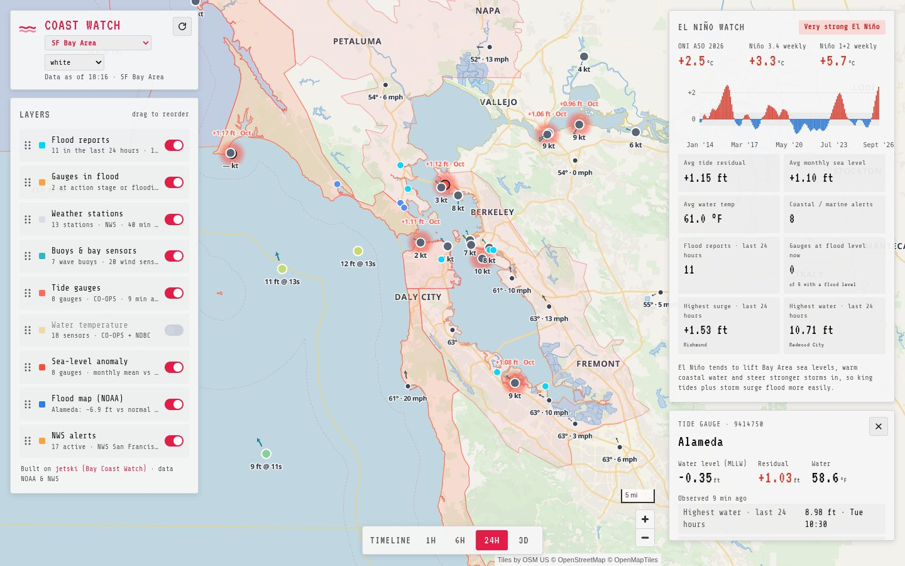
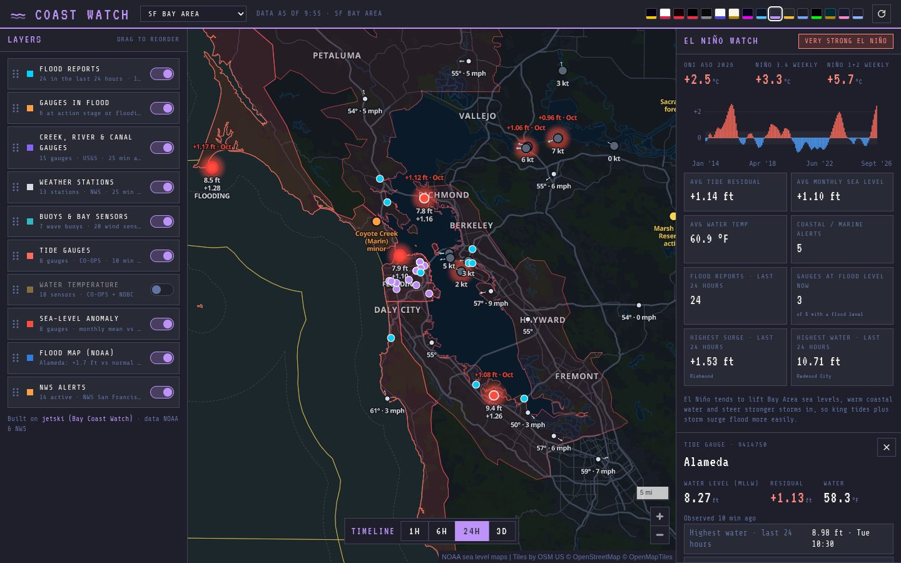
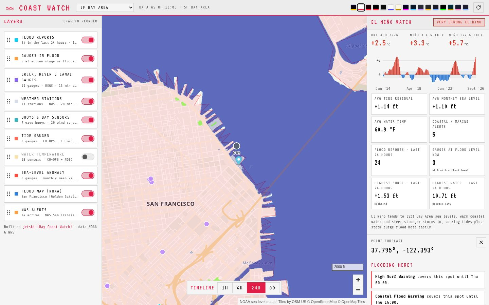
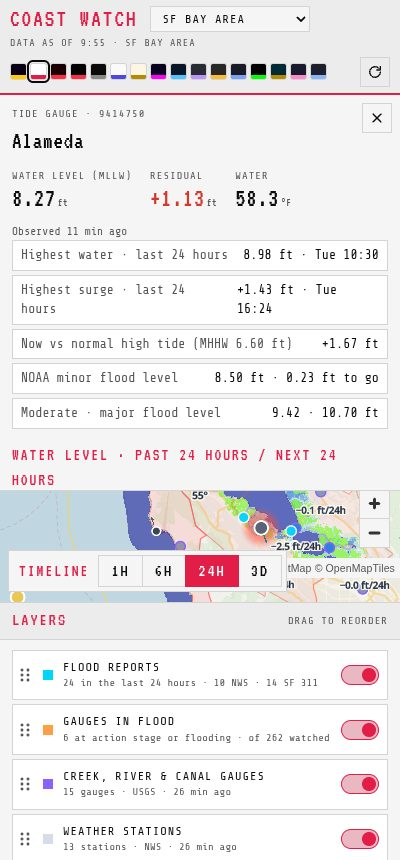

# Coast Watch

Live tides, storm surge, waves and **flooding** on one map, for the SF Bay Area, Seattle / Puget Sound and
Miami / South Florida. Runs at **https://tides.alola.lol**; a retro telemetry-screen front end for the same data
lives in [nviiiivn/tido](https://github.com/nviiiivn/tido) (https://tido.alola.lol).

A fork of [rishabhbajpailab/jetski](https://github.com/rishabhbajpailab/jetski) ("Bay Coast Watch"), rebuilt to run
on any small server (a Raspberry Pi here) instead of Cloudflare Workers, with regions, a timeline and flood data added.



| Dark theme (dracula) | "Flooding here?" at the Embarcadero | Phone |
|---|---|---|
|  |  |  |

## What it shows

- **Tide gauges** (NOAA CO-OPS): water level, residual / storm surge (observed minus predicted), the next highs and
  lows, normal high tide (MHHW), and NOAA/NWS minor, moderate and major flood levels. Gauges at flood level are ringed red.
- **Buoys and sensors** (NOAA NDBC): wave height and period offshore, wind, water temperature, and water level where
  a station reports it; inside SF Bay the NOAA PORTS wind sensors.
- **Flood map** (NOAA sea-level-rise inundation maps): the land the water reaches at the height the nearest tide
  gauge reads now, the highest it's forecast to reach in 48 h, or a fixed height.
- **Flood reports**: NWS Local Storm Reports of flooding (spotters, police, public, media) via the Iowa Environmental
  Mesonet, plus San Francisco 311 street/sewer flooding requests (DataSF).
- **Gauges in flood**: NOAA National Water Prediction Service river and tide gauges at action stage or flooding.
- **NWS alerts**, weather stations, monthly sea-level anomaly, El Niño indices, and flooding in the news (Google News).
- **"Flooding here?"**: click anywhere for the alerts covering that spot, reports near it, and NOAA's ground-height
  map against the nearest gauge's water and forecast.
- **Timeline** 1H · 6H · 24H · 3D for every chart, peak, report and news list.
- **Themes**: the alola.lol palettes (white by default, dark ones on the picker), VT323 / Share Tech Mono fonts.
- Opens on the Alameda tide gauge in the SF Bay Area, then remembers the last station you opened per region.

## Run it on your own server

Needs Node.js 20 or newer and outbound HTTPS to the public data sources. No API keys, no database.

```sh
git clone -b tides-alola https://github.com/nviiiivn/jetski.git coast-watch
cd coast-watch
npm install
npm run build      # builds the page into dist/
npm start          # serves dist/ and the data API on http://127.0.0.1:8970
```

Open http://127.0.0.1:8970/. The first visit to a region takes a few seconds while the server fetches it; after that
each data group is cached (tides and weather 5–6 min, buoys 15 min, flood reports 10 min, climate 6 h) and refreshed
in the background when it goes stale. Cached snapshots are kept in `.data/` so a restart starts warm.

| Environment variable | Default | What it does |
|---|---|---|
| `PORT` | `8970` | Port to listen on |
| `HOST` | `127.0.0.1` | Address to listen on (`0.0.0.0` to expose it without a proxy) |
| `UPSTREAM_TIMEOUT_MS` | `15000` | Timeout per upstream request; `40000` suits slow home links |
| `NWS_USER_AGENT` | `(coast-watch, self-hosted …)` | How the server identifies itself to api.weather.gov; NWS asks for your site name and a contact, e.g. `(tides.example.com, you@example.com)` |
| `TIDO_DIR` | `../tido` | Folder of the [TIDO](https://github.com/nviiiivn/tido) page, served at `/__tido/` and for any host name starting with `tido.` |

**Reverse proxy (Caddy):**

```caddyfile
tides.example.com {
	reverse_proxy 127.0.0.1:8970
}
```

**Reverse proxy (nginx):**

```nginx
server {
    server_name tides.example.com;
    location / {
        proxy_pass http://127.0.0.1:8970;
        proxy_set_header Host $host;
    }
}
```

**systemd (user unit), `~/.config/systemd/user/coast-watch.service`:**

```ini
[Unit]
Description=Coast Watch
After=network-online.target

[Service]
WorkingDirectory=%h/coast-watch
Environment=PORT=8970
Environment=UPSTREAM_TIMEOUT_MS=40000
ExecStart=/usr/bin/env node server/serve.mjs
Restart=on-failure

[Install]
WantedBy=default.target
```

`systemctl --user enable --now coast-watch` (and `loginctl enable-linger $USER` so it runs without a login).
After `git pull`, run `npm run build` for page changes and restart the service for server or station changes.

## Regions and stations

Every region, station and data source lives in `shared/stations.js`: map center and bounds, NOAA tide gauge ids,
NDBC buoy/sensor ids, NWS weather stations, the NWS offices whose alerts and storm reports to show, and the news
search. To add a region, copy one, fill in ids you have checked live, rebuild and restart.

## Data sources

NOAA CO-OPS (Tides & Currents) · NOAA NDBC · NOAA Office for Coastal Management sea level rise maps · NOAA National
Water Prediction Service · NWS api.weather.gov · NWS Local Storm Reports via the Iowa Environmental Mesonet ·
DataSF 311 · NOAA CPC (ENSO) · Google News search · map tiles by OpenStreetMap US, © OpenStreetMap contributors,
© OpenMapTiles · MapLibre GL · VT323 and Share Tech Mono fonts (SIL OFL, `site/fonts/OFL.txt`).

Flood maps are a model of ground height, not observations: drains, pumps and levees change what actually floods.
Reports and alerts are what people saw.

## Notes

- `npm test` still contains the original Cloudflare Worker tests; four of them (site build, cron pre-warm, R2 index,
  scheduled) fail outside Cloudflare and don't apply to the Node server.
- License: MIT (see `LICENSE`), same as the original project.

---

The original README follows.

---

# Bay Coast Watch

A small, map-first dashboard for following **El Niño and its effects on the San Francisco Bay Area coast**: tides and storm surge, monthly sea-level anomalies, coastal water temperature, offshore waves, and NWS weather alerts. Everything comes from free public U.S. government data.

Each dataset is a **layer on the map** that you can show or hide, fade, and drag to change its stacking order. Your layer settings are remembered in the browser.

It is a **point-in-time snapshot**, not a realtime feed: a static page that, on load, pulls a few pre-built JSON snapshots from a Cloudflare Worker. Each snapshot is cached for as long as its data actually stays current.

## Architecture

```
                 ┌──────────── Cloudflare ─────────────────────────────────────────┐
 browser ──GET / ──► bcw-site  (Worker + Static Assets: dist/)                     │
    │            │     │                                                           │
    │  /snapshot/*     │ service binding                                           │
    │  /forecast ──────┴──► bcw-data ──► edge cache ──► R2 bcw-snapshots ──► NWS   │
    │            │             ▲          (per colo)     (global)            CO-OPS│
    │            │             └── Cron Triggers pre-warm R2 on a schedule   NDBC  │
    │            └─────────────────────────────────────────────────────────  CPC ──┘
    └──► tiles.openstreetmap.us   (map tiles + fonts, direct)
```

| Piece | What it is |
| --- | --- |
| `site/` | The static front end: HTML, CSS, and ~30 KB of minified JS that renders the map, layer stack, charts and detail views. No parsing or upstream calls. |
| `scripts/build-site.mjs` | esbuild bundle into `dist/` with content-hashed filenames, plus a self-hosted copy of MapLibre GL under a versioned `/vendor` path. |
| `workers/site` (`bcw-site`) | Serves `dist/` from [Workers Static Assets](https://developers.cloudflare.com/workers/static-assets/) and forwards `/snapshot*`, `/forecast` and `/admin/*` to `bcw-data` over a service binding. The page and its data share one origin, so there's no CORS. |
| `workers/data` (`bcw-data`) | Fans out to NWS, CO-OPS, NDBC and CPC, parses (NDBC text, CPC fixed-width), normalises, slims (compact series, simplified zone shapes) and caches. It has no public URL of its own. |
| `shared/` | Station catalogs and the compact series format, used by both sides. |

### Snapshot groups and cache lifetimes

Data is grouped by how fast it changes. All of the numbers live in one file, `workers/data/src/groups.js`:

| Endpoint | Contents | Fresh for | Then served stale for | Pre-warmed |
| --- | --- | --- | --- | --- |
| `/snapshot/weather` | 13 NWS station observations, active NWS alerts | 5 min | 30 min | every 5 min |
| `/snapshot/tides` | 8 CO-OPS gauges: 36 h observed, 84 h predicted, highs and lows, water temp | 6 min | 30 min | every 5 min |
| `/snapshot/buoys` | 7 NDBC buoys: latest plus 3-day wave and SST series | 15 min | 2 h | every 15 min |
| `/snapshot/climate` | ONI (13 yr), weekly Niño indices, monthly mean sea level (3 yr) | 6 h | 7 days | every 6 h |
| `/forecast?lat&lon` | NWS point forecast for a ~1 km cell, built on demand | 30 min | 6 h | no (edge cache only) |
| *(internal)* zone shapes | NWS forecast-zone polygons for alerts | 24 h | n/a | no |
| *(internal)* `/points` lookup | NWS grid metadata for forecasts | 7 days | n/a | no |

How a request is served:

1. **Edge cache** (Workers Cache API, per data centre). If the copy there is fresh, it is returned.
2. **R2** (`bcw-snapshots`, global). The Cron Triggers write here, so a data centre's first visitor still gets a warm copy.
3. If the newest copy is only *stale*, it is returned at once and a refresh runs in the background (stale-while-revalidate).
4. If nothing usable exists, the Worker builds the snapshot from upstream while the request waits. If the agencies are down, it serves the newest copy it has, however old, instead of an error.

Freshness is judged by each snapshot's own `generatedAt`, not by when a cache entry expires. If every upstream call in a group fails, the build is rejected, so a good snapshot is never overwritten with an empty one. Responses carry `X-Snapshot-Status` (`hit`, `r2`, `stale`, `miss` or `stale-error`), `X-Generated-At` and a browser `Cache-Control` limited to the time the snapshot has left as fresh.

`GET /snapshot` lists every group with its TTL, cron and current age.

## Develop

Requires Node 20+.

```sh
npm install
cp workers/data/.dev.vars.example workers/data/.dev.vars   # optional: enables /admin/refresh locally
npm run dev          # builds dist/, runs both Workers locally → http://localhost:8787
npm test             # node:test: parsers, cache tiers, Worker routes, config consistency, build
npm run check        # build + `wrangler deploy --dry-run` for both Workers (no credentials needed)
```

`wrangler dev` simulates R2 and the Cache API locally and calls the real upstream APIs. To fire a cron by hand:

```sh
curl -X POST "http://localhost:8787/cdn-cgi/local/explorer/api/local/scheduled?worker=bcw-data" \
  -H 'Content-Type: application/json' -d '{"cron":"*/15 * * * *"}'
curl -X POST -H "Authorization: Bearer dev-token" "http://localhost:8787/admin/refresh?group=all"
```

To add stations, edit `shared/stations.js`. To change a cache lifetime or schedule, edit `workers/data/src/groups.js`, and if you add or change a `cron`, update `triggers.crons` in `workers/data/wrangler.jsonc` too. `test/config.test.js` fails if the two disagree, or if a group is pre-warmed less often than it goes stale.

## Deploy

Everything runs from GitHub Actions and is **manually triggered** (Actions → *workflow* → *Run workflow*):

| Workflow | Does |
| --- | --- |
| **Test** (`test.yml`) | `npm ci`, `npm test`, build, and a `wrangler deploy --dry-run` of both Workers. Needs no secrets. |
| **Deploy to Cloudflare** (`deploy.yml`) | Choose `all`, `data` or `site`. Runs the tests, creates the R2 bucket if it's missing, deploys `bcw-data` and then `bcw-site`, sets the `REFRESH_TOKEN` Worker secret, warms every cache, and smoke-tests each endpoint. |
| **Refresh data caches** (`refresh.yml`) | Force-refreshes one group or all of them via `POST /admin/refresh`. Has a commented-out `schedule:` if you'd rather drive refreshes from GitHub. |

One-time setup, on a GitHub environment named **`Prod`** (add required reviewers there if you want a deploy gate):

| Kind | Name | Value |
| --- | --- | --- |
| secret | `CLOUDFLARE_API_TOKEN` | API token from the **Edit Cloudflare Workers** template, scoped to your account and the `glizzy.dev` zone |
| secret | `CLOUDFLARE_ACCOUNT_ID` | your account ID |
| secret | `REFRESH_TOKEN` | any long random string (optional; enables `/admin/refresh`) |
| variable | `SITE_URL` | optional; defaults to `https://jetski.glizzy.dev` |
| variable | `NWS_USER_AGENT` | e.g. `(bay-coast-watch, you@example.com)`. api.weather.gov asks clients to identify themselves |

Cache refresh is config as code: the **Cron Triggers** in `workers/data/wrangler.jsonc` go live with every deploy of `bcw-data`. Three triggers are used, within the free plan's limit of five.

The site is served at **https://jetski.glizzy.dev**, a [Custom Domain](https://developers.cloudflare.com/workers/configuration/routing/custom-domains/) declared in `workers/site/wrangler.jsonc`. Because `glizzy.dev`'s DNS is on Cloudflare, the deploy creates the DNS record and certificate itself; just make sure no DNS record for `jetski` already exists. The `workers.dev` URL is turned off so there's one canonical address.

The R2 bucket needs no setup beyond existing: `bcw-data` reaches it through the `SNAPSHOTS` binding in its wrangler config, and writes the snapshots itself (on the first request and on every cron). It starts empty, stays private, and needs no public access or uploads.

From a laptop instead: `npx wrangler login`, `npx wrangler r2 bucket create bcw-snapshots`, `npm run deploy:data`, `npm run deploy:site`.

## Layers

| Layer | Source | What it shows |
| --- | --- | --- |
| Weather stations | [NWS API](https://www.weather.gov/documentation/services-web-api) | Latest airport observations: temperature, and wind as arrows |
| Offshore buoys | [NOAA NDBC](https://www.ndbc.noaa.gov/) | Wave height and period, wind, sea temperature, with 3-day charts |
| Tide gauges | [NOAA CO-OPS](https://api.tidesandcurrents.noaa.gov/api/prod/) | Water level above MLLW, plus the **residual** (observed minus predicted, i.e. surge) |
| Water temperature | CO-OPS + NDBC | Bay and offshore water temperatures |
| Sea-level anomaly | CO-OPS monthly means | Last monthly mean sea level compared with the 1983–2001 epoch. El Niño lifts this |
| NWS alerts | NWS API | Active alerts from the Bay Area office (land and marine zones) |

**El Niño watch** card: the [CPC](https://www.cpc.ncep.noaa.gov/data/indices/) Oceanic Niño Index (ONI) and the weekly Niño 3.4 and Niño 1+2 anomalies, with a summary of current Bay signals.

**Click** a station for charts and details, an alert for its full text, or anywhere else on the map for the NWS point forecast. The page re-checks its snapshots every 5 minutes while the tab is visible, and the refresh button bypasses the browser cache.

## Notes

- The OSM US Tileservice is for **non-commercial** use and requires the attribution shown in the map corner. See its [usage policy](https://tiles.openstreetmap.us/usage-policy/).
- MapLibre GL is pinned to `4.7.1` in `package.json` and served from the site itself, not a CDN.
- CO-OPS station IDs can be found at [tidesandcurrents.noaa.gov](https://tidesandcurrents.noaa.gov/).
